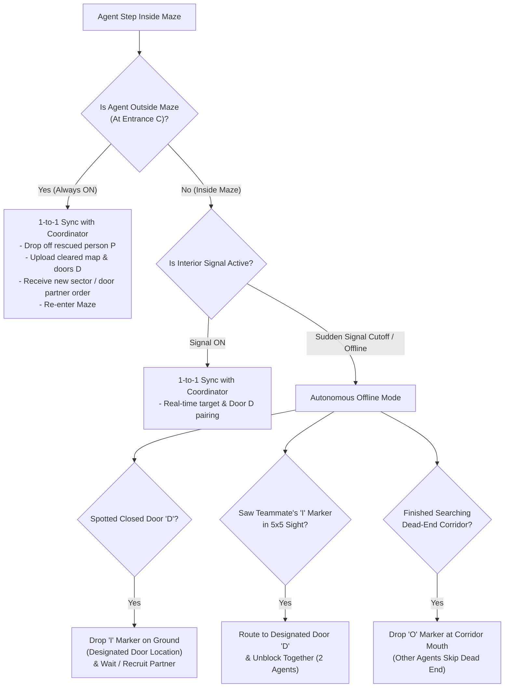

# GreatUniHack 2026 — Neptune North Challenge: Resilient Multi-Agent Search & Rescue

> *"Actors work better together — Design a system where multiple agents keep working toward a shared goal, even when communication fails."*

This repository implements an autonomous, communication-resilient **Search & Rescue (SAR)** system featuring **1 Outside Coordinator (`C`)** and **3 Autonomous Field Agents (`A1`, `A2`, `A3`)** operating inside a hazardous maze with heavy 2-agent doors (`D`) and sudden communication blackouts.

---

## 1. Meaning of Maze Elements

The floor plan is represented as a 2D grid array where each cell contains one of the following elements:

| Symbol | Name | Meaning & Behavior |
| :---: | :--- | :--- |
| **`0`** / `'0'` | **Path** | Walkable open corridor or room cell. |
| **`1`** / `'1'` | **Wall** | Impassable barrier. Blocks both agent movement and the centred $5 \times 5$ line-of-sight vision behind it. |
| **`A1`, `A2`, `A3`** | **Field Agents** | The 3 autonomous rescue agents deployed into the maze. Can enter and exit the maze multiple times. |
| **`C`** | **Coordinator / Entrance** | Stationed outside the maze at the entrance/perimeter. Signal is **always ON** when an agent is at `C` / outside the maze. |
| **`P`** (`P1..Pn`) | **Person / Target** | Trapped survivor to be located, picked up (1 per agent trip), and escorted out of the maze to `C`. |
| **`D`** | **Heavy Door** | Blocks movement and line-of-sight behind it while closed. **Requires 2 agents standing adjacent to `D` simultaneously** to remove/unblock (`D` $\to$ `0`). |
| **`I`** | **Invite Marker (Offline)** | Ground message left by an agent when signal is down. Instructs any teammate who sees `I` in its $5 \times 5$ sight to go to the designated Door `D` location to help unblock it. |
| **`O`** | **Dead-End Marker (Offline)** | Ground message left by an agent when signal is down at the mouth of a searched cul-de-sac. Tells other agents that **the road after `O` is a dead end** so they never waste steps entering it. |

---

## 2. Outside Coordinator (`C`) Logic

The [`Coordinator`](neptune_sar/coordinator.py) remains outside the maze at the entrance perimeter and communicates strictly **1-to-1** with whichever agent has an active signal link.

### Step-by-Step Coordinator Responsibilities:
1. **Pre-Mission Spatial Partitioning ($t = 0$)**:
   - Analyzes the known structural floor plan (`0` paths and `1` walls) via topological BFS flood-fill from the entrance.
   - Partitions all walkable cells into **3 balanced spatial sectors ($S_1, S_2, S_3$)** and briefs each agent (`A1` $\to S_1$, `A2` $\to S_2$, `A3` $\to S_3$) along with the target goal count $N$.
2. **1-to-1 State Synchronization (`sync_with_agent`)**:
   - **Coverage Union**: Merges the syncing agent's `newly_cleared_cells` into `global_cleared_cells` and returns all tiles cleared by teammates so no agent searches the same room twice.
   - **Conflict-Free Target Registry**: Tracks every discovered target through monotonic state transitions:
     $$\text{DISCOVERED} \longrightarrow \text{CARRYING} \longrightarrow \text{RESCUED}$$
   - **2-Agent Door (`D`) Breach Pairing**: When an agent reports a closed door `D`, the Coordinator assigns the **2 closest available agents** (`priority_door_pos`) to converge on `D` and unblock it together.
   - **Dark-Agent Detection & Rebalancing**: Tracks the step timestamp of each agent's last sync. If an agent has been silent for $\ge 18$ steps (due to interior comms failure), the Coordinator flags it as **Dark** and redirects syncing agents to cover its unsearched sector or unclaimed targets.

---

## 3. Agent Moving & Search Logic (`A1`, `A2`, `A3`)

Each agent ([`agent.py`](agent.py) / [`neptune_sar/agents.py`](neptune_sar/agents.py)) runs an independent decision loop at every step and can **go in and out of the maze multiple times** (e.g., to extract rescued people to the entrance, sync critical intelligence at the entrance, and re-enter for remaining targets).

### A. Perception: Centred $5 \times 5$ Sight with Occlusion
- At position $(r, c)$, the agent inspects the $5 \times 5$ window $[r-2 \dots r+2] \times [c-2 \dots c+2]$.
- **Raycasting Occlusion**: A cell in the $5 \times 5$ window is visible **if and only if** the ray from $(r, c)$ to that cell is not blocked by an intermediate wall (`1`) or closed door (`D`).
- Within this visible window, the agent detects walkable tiles (`0`), trapped people (`P`), closed doors (`D`), teammates (`A1..A3`), and floor markers (`I` and `O`).

### B. Per-Step Action Priority Hierarchy (FSM)
At each step, every agent chooses its next move using this priority order:
1. **`MISSION_COMPLETE`**: All $N$ targets are rescued (or 100% of the map is cleared with no unrescued targets) $\to$ exit the maze to the entrance.
2. **`EXTRACT_TARGET`**: Currently carrying a person (`P`) $\to$ follow shortest BFS path out of the maze to the entrance (`C`), drop off the person, sync with the Coordinator, and re-enter the maze if targets remain.
3. **`APPROACH_TARGET`**: A discovered, unclaimed person (`P`) is reachable $\to$ move directly to pick them up.
4. **`ASSIST_OPEN_DOOR` / `WAIT_FOR_DOOR_PARTNER`**: A closed Door `D` needs unblocking (either spotted directly, assigned by the Coordinator, or read from an **`I`** ground marker) $\to$ navigate to a cell adjacent to `D`. As soon as **2 agents** are adjacent to `D`, the door is removed (`D` $\to$ `0`).
5. **`RELAY_SYNC`**: Prolonged interior comms blackout while holding high-value unsynced intel (or waiting at a door `D` offline for $>12$ steps without a partner) $\to$ return to the entrance where signal is guaranteed **ON**.
6. **`SEARCH_PRIMARY`**: Explore uncleared frontiers inside the agent's primary assigned sector.
7. **`SEARCH_SPILLOVER`**: Primary sector is 100% cleared $\to$ deterministically spill over into teammates' sectors ($S_1 \to S_2 \to S_3 \to S_1$) without waiting for central instructions.

### C. Distinct Independent Search Strategies per Agent
To ensure each actor makes independent decisions that support the group:
- **`A1` — Deep-Infiltration Vanguard (Sector 1)**:
  Scores candidate frontiers by rewarding high topological depth from the entrance (`travel_distance - 0.35 * depth_from_entrance`). Pushes straight into the deepest interior rooms first so that if signal drops suddenly, the hardest-to-reach rooms are searched early and cleared on the way back.
- **`A2` — High-Visibility Recon Scout (Sector 2)**:
  Scores candidate frontiers by expected **$5 \times 5$ Information Gain** (number of currently unseen walkable tiles that will be revealed from that vantage point per step traveled). Sweeps open intersections and large rooms first to spot survivors rapidly.
- **`A3` — Adaptive Support & Comms-Relay Specialist (Sector 3)**:
  Performs systematic near-to-far wavefront sweeping and acts as an **autonomous information mule**: if interior signal is down for $\ge 24$ steps after accumulating $\ge 20$ new tiles or spotting a target/door, `A3` briefly exits to the entrance to update the Coordinator and pivots to cover any dark teammate's sector.

---

## 4. Logic Under Different Signal Conditions



### 1. Normal Signal Condition (Connected Inside)
- Agents sync 1-to-1 with the Coordinator in real time.
- Cleared tiles are shared globally via the Coordinator.
- When an agent discovers a heavy Door `D`, the Coordinator immediately dispatches the nearest free teammate so both meet at `D` and unlock it.

### 2. Sudden Signal Cutoff (Interior Blackout)
- Signal can drop suddenly at any step without warning.
- Agents **never freeze or wait for central commands**; they immediately continue using their local belief state (`local_cleared_cells`, `known_targets`, `known_closed_doors`) and sector spillover rules.
- **Stigmergic Ground Communication (`I` and `O` Markers)**:
  - **Leaving & Reading `'I'` (Door Invite)**: When an offline agent encounters a closed Door `D`, it drops an `'I'` marker on the floor (at junctions/approaches) containing the designated coordinates of `D`. Any teammate whose $5 \times 5$ sight crosses `'I'` reads the target coordinate, switches to `ASSIST_OPEN_DOOR`, and walks to `D` so the 2 agents unblock it together without needing radio signal.
  - **Leaving & Reading `'O'` (Dead End)**: When an offline agent finishes sweeping a cul-de-sac/dead-end branch with no targets or doors, it places an `'O'` marker at the corridor entrance. Any teammate seeing `'O'` in its $5 \times 5$ sight marks the entire branch behind `'O'` as cleared and never enters that dead end.

### 3. Outside the Maze (Signal Always ON + Multi-Trip Re-Entry)
- Whenever an agent reaches the entrance/perimeter (`C`), **signal is guaranteed to be ON** regardless of interior blackouts.
- Agents go **in and out of the maze multiple times**:
  - Every time an agent carries a rescued person (`P`) out to the entrance, it automatically reconnects with the Coordinator, uploads all offline discoveries (`cleared_cells`, `D` locations, rescued IDs), receives updated global directives, and **re-enters the maze** until all $N$ people are rescued.
  - If an agent waits at a locked Door `D` offline and no partner passes by within 12 steps, it walks out to the entrance to report `D` to the Coordinator (where signal is ON) and brings a partner back inside.

---

## 5. Running the Simulation & Tests

Run the automated test suite and multi-scenario simulation harness with standard Python 3 (zero external dependencies):

```bash
# Run unit & integration tests (5x5 occlusion, 2-agent Door 'D', 'I'/'O' markers, sudden blackout)
python3 -m neptune_sar.tests.test_sar

# Run the 3-scenario comparison demo
python3 -m neptune_sar.demo_sim
```
